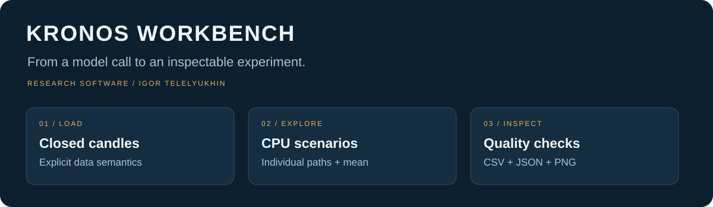
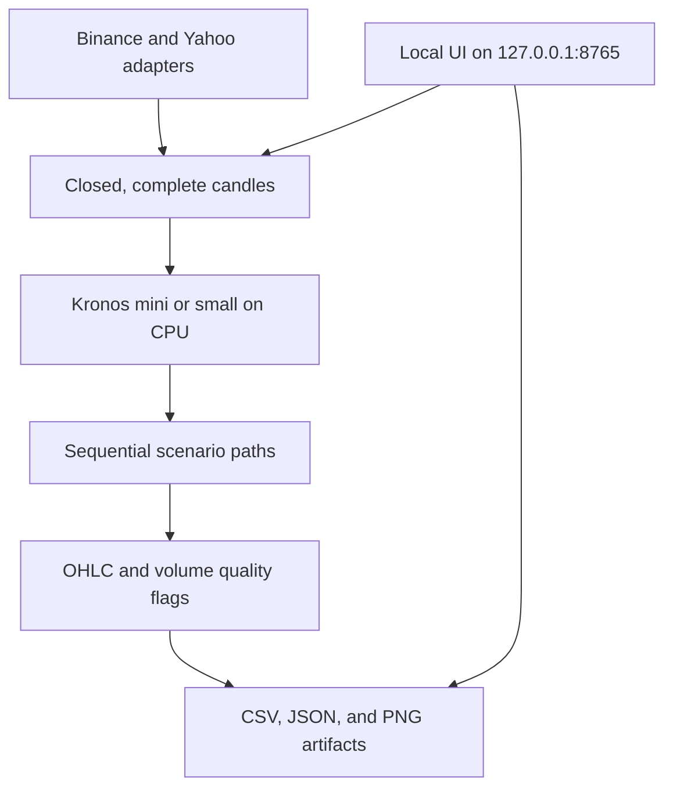

# Kronos Workbench

> Explore Kronos on a local CPU with individual scenario paths, visible data-quality checks, and inspectable CSV/JSON outputs.



**Local CPU workflow** · **Individual scenario paths** · **Inspectable research artifacts**

**Status:** `Research prototype · Local UI · Upstream model credited`

[Overview](#in-30-seconds) · [Architecture](#architecture) · [Setup](#quick-start) · [Validation](docs/VALIDATION.md) · [Contact](#contact)

**This is not investment advice.** Model paths are research outputs, not trading recommendations. Agreement across samples is not a calibrated probability of success.

## In 30 seconds

Kronos Workbench wraps the open-source **Kronos** model in a local research environment: choose a market, generate multiple possible paths, inspect the raw outputs, and keep a reproducible record of every run.

The contribution here is the **workbench**: market adapters, a browser interface, sequential scenario sampling, quality checks, session handling, CPU execution controls, and inspectable CSV/JSON artifacts.

The Kronos model itself was created by its upstream authors. This repository does not claim authorship of it.

Built by **Igor Telelyukhin**, who organizes how people and businesses work with AI where mistakes are expensive. This workbench is a published research tool. Independent stress testing of trading strategies is a [separate consulting practice](https://github.com/TelelyukhinIgor/TelelyukhinIgor/blob/main/docs/strategy-validation.md).

## For technical due diligence

### Why this exists

Running a model once is easy to confuse with building a useful research tool. A practical workbench also needs to answer:

- Which candles actually entered the model?
- Were those candles closed, complete, and correctly timestamped?
- Did the generated OHLC values obey basic price constraints?
- How do individual paths differ from their mean?
- Can the same input and parameters be inspected later?
- Can the experiment run on a normal Intel Mac without a GPU?

Kronos Workbench makes those questions part of the workflow.

### Architecture



| Module | Responsibility |
|---|---|
| `market_sources.py` | Instrument catalog, Yahoo adapter, 4h aggregation, and future session timestamps |
| `run_kronos.py` | Binance adapter, CPU model loading, sequential scenarios, quality metrics, and saved artifacts |
| `kronos_window.py` | Local HTTP server, a single running job, cancellation, file access, and shutdown |
| `kronos_window.html` | English research interface, charts, settings, progress, run history, and downloads |
| `setup_kronos.sh` | Project-local Python environment, pinned upstream checkout, and recorded dependencies |
| `Launch.command` | Project-relative macOS launcher |
| `test_kronos_window.py` | Eleven offline checks with synthetic fixtures |

A longer map is in [Architecture](docs/ARCHITECTURE.md). The server binds only to `127.0.0.1:8765`. Mutations require a process-generated token and Host/Origin checks. Result files are resolved under `signals/` with path traversal rejected.

### Features

- **Local browser UI**, served only on `127.0.0.1:8765`.
- **Six instruments:** Bitcoin, S&P 500, Nasdaq-100, EUR/USD, gold futures, and WTI futures.
- **15m, 1h, 4h, and 1d** in the interface.
- **Kronos-small and Kronos-mini**, with explicit context and sample limits.
- **Sequential scenario generation**, keeping individual paths rather than only an average.
- **Reusable in-process model loading** and project-local weight caches.
- **Cancellable runs**, progress logs, saved run history, and downloadable artifacts.
- **Price-quality flags**, with invalid output reported rather than silently repaired.
- **Session-aware timestamps**, with holiday limitations stated explicitly.

### Quick start

Use Python **3.10–3.12**. The tested Intel macOS configuration uses Python 3.11, PyTorch 2.2.2, and NumPy 1.26.4.

```bash
git clone https://github.com/TelelyukhinIgor/kronos-workbench.git
cd kronos-workbench
bash setup_kronos.sh
kronos_env/bin/python kronos_window.py --open-browser
```

On macOS, `Launch.command` provides a project-relative launcher after installation. Keep it inside the repository folder.

The setup script checks out the recorded upstream commit and installs the recorded Python dependencies. Installation downloads software but does **not** start market-data requests or model inference. Model weights are downloaded into the project cache when a forecast first needs them.

#### Command-line run

```bash
kronos_env/bin/python run_kronos.py \
  --symbol EURUSD --timeframe 1h \
  --model mini --lookback 400 --pred_len 24 --samples 5
```

This command requests live data and starts CPU inference. A 24-candle horizon means 24 model candles, not necessarily 24 consecutive clock intervals.

### Inputs and outputs

| Artifact | Contents |
|---|---|
| `input.csv` | Exact model input |
| `forecast.csv` | Mean OHLC, volume, and turnover across scenarios |
| `trajectories.csv` | Individual scenarios, identified by sample ID |
| `metadata.json` | Parameters, source semantics, revisions, input hash, timing, and quality flags |
| `forecast.png` | Historical close and forecast close paths |

Files are written under `signals/<run-id>/`. The historical directory name does not imply that outputs are validated trading signals.

See [Data contract](docs/DATA_CONTRACT.md) for instrument mappings, missing-volume conventions, candle calendars, and interpretation limits.

### What has been checked

Historical runs established that the original workbench could load and run Kronos on CPU, save individual scenarios, and expose them through the local interface.

This English publication copy passes **11 offline checks** covering aggregation gaps, incomplete candles, daily dates, weekends, DST, futures breaks, safe result paths, and synthetic artifact loading. Those checks were re-run successfully on this publication host. They do not load the model or request market data.

Historical runtime measurements are environment-specific. They are not a promise about another machine or an estimate of forecast skill.

### Limits of applicability

- Model paths are research outputs, not trading recommendations.
- Agreement across samples is not a calibrated probability of success.
- Some generated candles can violate OHLC or volume constraints; inspect the quality flags.
- Yahoo data comes from an unofficial endpoint and may be delayed or unavailable.
- Holiday and special-session calendars are incomplete.
- Index levels, ETF prices, spot FX, and rolling futures series are different instruments.
- No independent predictive edge or profitable trading system is established by this project.

See [Validation](docs/VALIDATION.md).

### What is intentionally not included

- Upstream Kronos source (retrieved at setup from the recorded commit)
- Model weights (downloaded into a project-local cache on first use)
- Provider datasets or saved forecast histories
- Performance figures or claims of forecast skill
- A public network service — the UI is local-only

### Disclaimer

This software is a research tool for inspecting model paths and data quality. It is **not investment advice**, not a signal service, and not a system for placing orders. Use of the code, charts, or forecasts is at your own risk.

### License

Original workbench code and documentation are under the [PolyForm Noncommercial License 1.0.0](LICENSE). The upstream Kronos model code remains under MIT; its notice is preserved in [UPSTREAM-LICENSE](UPSTREAM-LICENSE). Model-weight terms remain those published with the model assets. See also [THIRD_PARTY.md](THIRD_PARTY.md) and [NOTICE](NOTICE). Commercial use of the original workbench code requires a separate license from the author.

### Credits

Workbench engineering and product direction: **Igor Telelyukhin**, developed with AI assistance.

Upstream model: [shiyu-coder/Kronos](https://github.com/shiyu-coder/Kronos), commit `67b630e67f6a18c9e9be918d9b4337c960db1e9a`.

### Contact

If you need an independent review of a trading process or strategy — especially where tail risk, grid or martingale structures, or overfitting are a concern — or if you want a local research workbench adapted to your own desk:

- Email: [telelyhina@icloud.com](mailto:telelyhina@icloud.com)
- LinkedIn: [Igor Telelyukhin](https://www.linkedin.com/in/igor-telelyukhin/)

This repository is a demonstration of a local research tool. It does not install or start model inference until you run it yourself.
